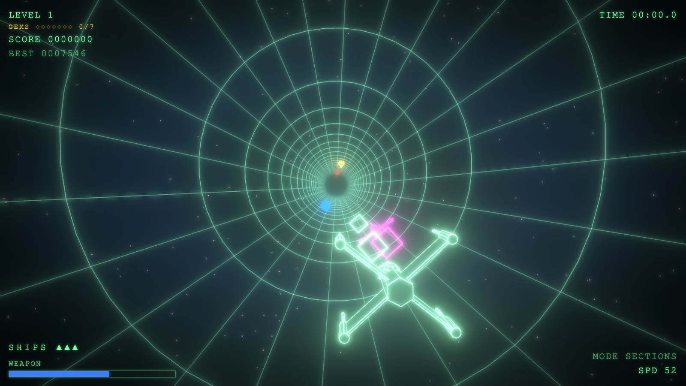

# Wormhole

> A small, polished neon vector flyer: pilot a lone craft down a wormhole through spacetime and chart how deep you can go.



Wormhole is set inside a tear in spacetime - a wormhole that opened with no way back,
where the deeper you fall, the slower time runs for you. You pilot a lone craft down
its throat, drawn as glowing neon wireframe on near-black, diving as far into the
unknown as you can hold the line. There is no finish, only how deep you get. It is
retro-INSPIRED, not retro-cheap: a modern machine doing a vector look, not a 1990s
mockup.

The soul of the game is the movement. The craft is not free-flying - it hangs near
the bottom of the tube under a gravity-like pull and steers only left / right,
climbing the curved wall like a pendulum. Pumping left-right-left builds amplitude
to ride high up the wall, or all the way over the top.

## Controls

| Action | Keys |
|--------|------|
| Steer / swing up the walls | Left / Right arrows, or A / D |
| Fire the forward gun | Space |
| Choose ship + difficulty (title screen) | Up / Down picks the row, Left / Right cycles it |
| Start the run | Space or Enter |
| Return to the title screen (after game over) | Enter |
| Pause / resume | Esc |
| Mute / unmute music (sound effects keep playing) | M |

You do not control speed - the tube section sets it (see Gameplay). Two extra keys
are for tuning rather than play: **G** cycles the flight mode and **P** toggles an
FPS / frame-time overlay.

## Gameplay

You only steer and shoot. Everything else flows from the swing.

- **Speed and feel come from the tube section.** Sections cycle slow -> normal ->
  fast and back. Slow sections pull hard and swing heavy (yellow walls), fast ones
  are light and floaty (blue walls), normal sits in between (green). The walls show
  the upcoming section's colour ahead of you.
- Ride into **blue orbs** to recharge your weapon (the blue bar).
- Ride into **gold gems** for score - and to advance. Gems come in **lines**: a line
  shows the swing that collects it. Hold the key as the line climbs, let go where it
  turns, and gravity carries you through the rest. In blue sections a ring of gems
  runs right over the top. Each gem in a row chimes one note higher.
- Each level has a **gem quota** (the pip row top-left). When it is met the row reads
  READY and the next level starts at the end of the cycle. Fall short and the level
  repeats (an amber REPEAT banner says how many gems are still missing; the gems you
  already have carry over), so you cannot coast through on dodging alone. A cycle
  offers 32 to 40 gems. The quota is 15 at level 1, 19 at level 2, 23 at level 3 and
  27 from level 4, so a player who collects nearly every gem never repeats a level.
- Avoid **red spiky mines** - a hit costs one of your three ships, with brief
  invulnerability after. Mines sit beside the gem lines, never on them: the gems mark
  the clear way through. The first ten seconds of a run have no mines.
- Lost ships are won back by fighting. While a ship is missing, every raider you
  destroy leaves a **small green cross** on the wall where it died. Ride into it: each
  one fills a segment of the green bar next to your ships, and a full bar gives a ship
  back (up to your starting three). A cross you miss is gone. The bar is short at
  level 1 (4 crosses) and grows by one per level. With all three ships no crosses drop.
- **Magenta raiders** arrive in waves, as a squad with a shape, each at its own depth.
  Their nose glows white-hot before every shot, with a rising whine from that side:
  that line is about to be fired down, so swing off it. From level 3 one raider in
  the squad is a hunter. It slides to wherever you are, stops, and fires down your
  line, so no place on the wall is safe to park. Shoot raiders with the forward gun:
  a dead-centre hit destroys one outright, a glancing hit only chips it. A kill
  scores points and refunds a little weapon charge. When a wave is destroyed there
  are a few quiet seconds. Raiders also hold their fire for a moment around every
  level change, while the speed drops and the level banner shows.
- Difficulty climbs with each level: the tiers get faster, the raiders fire sooner
  and more often, the mines get denser, and a score multiplier rises each level.
  Levels 1 and 2 are a warm-up. From level 3 the game asks for real play.
- The title screen has a menu: pick one of **three ships** (RAPTOR, FALCON, DELTA - a
  look, not an advantage; they all fly the same) and a **difficulty**. MILKY WAY is
  the gentle mode for children (raiders fire less than half as often, fewer mines,
  a slow ramp), ORION is the standard game, QUASAR starts deep and pays a higher
  score multiplier from the first gem. Both choices are remembered for your next visit.
- Firing spends weapon charge; run the bar dry and the gun goes quiet (the bar turns red and
  reads RECHARGE) until blue orbs top it up - but this never ends the run.
- The run ends only when your ships run out. The game-over panel names what ended the
  run. Your local best score persists. (The best score counts from zero for this
  version, because gems score differently now. A best score from an earlier version
  stays stored in the browser under `wormhole.best` and is not shown.)

## Running it

Requirements: Node.js + npm. Targets current Chrome and Safari on macOS.

```bash
npm install
npm run dev       # then open the printed localhost URL
```

Build a static, fully offline bundle:

```bash
npm run build     # output in dist/ - runs offline from a local folder
npm run preview
```

There is no backend and no accounts. The best score is kept in `localStorage`.

## Tech

TypeScript (strict) + Vite + Three.js. No game engine.

- The neon glow is GPU bloom (`UnrealBloomPass`), on by default - it is the look,
  not an afterthought.
- Glowing strokes use fat lines (`Line2`); the ship, wall objects (orbs, gems,
  mines), and raiders are edge-lit solids - glowing edges over a near-black fill -
  built procedurally in code so the whole game stays offline and on-aesthetic.
- The pendulum physics runs on a fixed timestep (semi-implicit Euler), decoupled
  from rendering, so the swing feels weighty and momentum-driven.
- Audio is Web Audio: a streamed music track plus procedural sound effects
  synthesised in code (no large asset files for the cues). Press M to mute the music.
- All feel constants live grouped in `src/config.ts` for fast tuning.

## Status

Early but playable.

- **Built**: scrolling wireframe tube, procedural edge-lit ship, damped-driven
  pendulum physics, banking chase cam with a view that widens with speed; speed-tiered
  "sections" flight where the tube section sets both speed and gravity; gem-gated
  difficulty levels (rising speed, a score multiplier, more pressure; each level
  unlocked by collecting its gem quota); gem lines (gems and mines placed as flyable
  phrases); weapon-charge orbs; green crosses dropped by destroyed raiders, which restore lost ships and top up the weapon; a forward gun with pooled
  projectiles; magenta raiders in waves with formations and a hunter; lives with
  invulnerability; sound and banner cues for every game event; a run timer; music and
  procedural sound effects; a title screen with a ship selector (three hulls, live
  3D preview) and three difficulty modes; a minimal in-theme HUD, score with a
  persistent local best, and a deep-space backdrop with stars.
- **Tested by bots**: seeded bot players play the real game and measure how it plays
  (`npm run playtest`, see [playtest/README.md](playtest/README.md)).
- **Next**: play it by hand against the bot numbers, a mine pattern that asks more of a
  skilled player, and a raider that punishes never shooting.

See [CLAUDE.md](CLAUDE.md) for the full design spec, physics model, architecture,
and roadmap, and [docs/next-level-spec.md](docs/next-level-spec.md) for the design
and the measurements behind the raider waves, the gem lines and the difficulty curve.
